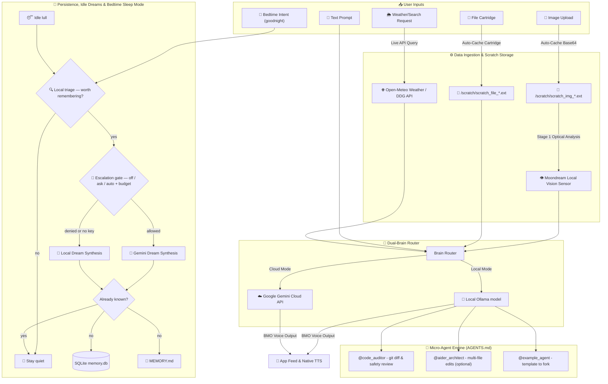

# 🎮 more

### *be more.*

A self-hosted, local-first AI companion styled after a certain living video game console.
Runs entirely on your own hardware against a local [Ollama](https://ollama.com) model —
chat, voice, vision, live telemetry, and a tool engine that can actually operate your
machine. Ships as a web app and an Android APK.

<sub><i>The name: BMO is "Be MOre", and <code>more</code> is the Unix pager — the little program
that shows you what's already on your machine, one page at a time. Both readings fit. The
companion it ships with is BMO; see <a href="#-whats-coming">what's coming</a> for the rest.</i></sub>

**Version:** v7.4.0 · **Web UI:** `http://localhost:18789` · **Vite dev server:** `http://localhost:5173`

> ⚠️ **Read before exposing this to a network.** BMO can execute shell commands on the
> machine running the server. The only thing standing between the internet and a shell on
> your box is the API token you set. See [Security](#-security) below.

---

## 🚀 Getting Started

### Prerequisites

| Requirement | Notes |
|---|---|
| **Python 3.10+** | Runs the FastAPI backend. |
| **Node.js 22+** | Required by the Capacitor 8 CLI. A `.nvmrc` is included (`nvm use`). |
| **[Ollama](https://ollama.com)** | Provides the local model. Must be running. |
| **A chat model** | Any tool-capable Ollama model. `qwen2.5:3b` is a good default — see below. |
| **`moondream`** *(optional)* | Only needed for image/vision replies. |
| **JDK 21 + Android SDK** *(optional)* | Only needed to build the Android APK. Capacitor 8 requires 21 — 17 fails with `invalid source release: 21`. |

### Install

```bash
git clone https://github.com/Theofiledes/more.git
cd more
./setup.sh
```

That's the whole thing. `setup.sh` checks your system dependencies, creates the
virtualenv, installs both dependency trees, generates your API token, pulls a model if you
don't have one, installs the commit guard, builds the UI, and runs the verifier. It's safe
to re-run — **an existing `.env` is never overwritten**, so your token and settings
survive.

It asks before installing anything system-wide and never runs `sudo` without your say-so.

```bash
./setup.sh --yes        # assume yes to those prompts (ssh / scripted runs)
./setup.sh --no-model   # skip the multi-GB model download
```

Then:

```bash
./wake-bmo.sh
```

<details>
<summary><strong>Manual install</strong> — if you'd rather do it by hand, or setup.sh doesn't fit your platform</summary>

```bash
# 1. Backend
python3 -m venv venv
source venv/bin/activate
pip install -r requirements.txt

# 2. Frontend
npm install

# 3. Configuration — REQUIRED. The server refuses to start without a token.
cp .env.example .env
python3 - <<'PY'
import pathlib, re, secrets
env = pathlib.Path(".env")
env.write_text(re.sub(r"(?m)^VITE_BMO_API_KEY=.*$",
                      "VITE_BMO_API_KEY=" + secrets.token_urlsafe(32),
                      env.read_text()))
print("Token written to .env")
PY

# 4. Pull a model
ollama pull qwen2.5:3b
ollama pull moondream        # optional — only for image/vision replies
```

> `.env.example` already ships an empty `VITE_BMO_API_KEY=` line, which is why the command
> above rewrites it in place. If you'd rather paste a token in by hand, replace that line
> — don't add a second one above it. `.env` is read last-value-wins, so a trailing empty
> `VITE_BMO_API_KEY=` silently blanks whatever you set earlier, and BMO then refuses to
> boot with a token error that points nowhere obvious.

Then `npm run build`, and you're at the same place `./setup.sh` would have left you.

</details>

**Choosing a model.** The one that matters most is whether it fits in your VRAM — a model
that spills to CPU is many times slower. On a 4GB card, a 3B model at Q4 answered in ~5s
where a 9B took ~26s for the same prompt. Check with `ollama ps` after sending a message:
if `SIZE_VRAM` is well below `SIZE`, part of it is running on the CPU.

Also prefer a model that follows instructions closely. BMO reports tool results (weather,
shell output) back to you, and some small models embellish — one tested model invented a
kernel version rather than reporting the real one. `docs/MODEL_SEARCH_PROMPT.md` has a
prompt for finding candidates that fit your hardware.

### Run

```bash
./wake-bmo.sh
```

This starts Ollama (if needed) and the BMO server, then prints your access URLs. Open the
laptop link it gives you — it carries your token, and BMO opens straight into the chat.
There's no login screen.

To run a second checkout alongside a live one (testing an upgrade, say), give it its own
port so the two don't collide:

```bash
BMO_PORT=18790 ./wake-bmo.sh
```

**Verify your install:**

```bash
python3 scripts/check_setup.py
```

Checks your token, Ollama, the model's real context window, the server, auth, and a live
round trip — and tells you exactly what to change for anything that fails.

To rebuild the web UI after changing frontend code:

```bash
npm run build     # server.py serves dist/ directly
npm run dev       # or hot-reload dev server on :5173
```

### Context window (important)

Ollama defaults new models to a small context (often 4096), which makes BMO forget things
mid-conversation. Set it explicitly on your model and tell BMO the true value:

```bash
ollama show --modelfile <your-model> > Modelfile
echo "PARAMETER num_ctx 16384" >> Modelfile
ollama create <your-model> -f Modelfile
ollama ps          # confirm "context_length"
```

Then set `BMO_CONTEXT_LIMIT` in `.env` to the **same number**. This value doesn't change
the model — it keeps the context gauge and history trimming honest. If you swap models,
redo this, or BMO will silently misreport how much room it has left.

### Optional: voice input

Push-to-talk transcription needs one extra dependency, kept out of the base install
because it pulls in a model download:

```bash
pip install -r requirements-voice.txt
```

Without it the mic button reports that voice input isn't configured; everything else works
normally. Tune the model with `WHISPER_MODEL_SIZE` in `.env` (`tiny`→`large-v3`).

### Optional: cloud brain (Gemini)

BMO is local-only unless you give it a key. Set one in `.env` to unlock `GEM BMO` mode and
let dream synthesis reach for a bigger brain:

```bash
GEMINI_API_KEY=your-key-here
```

Note it is **not** `VITE_`-prefixed, deliberately — the key stays server-side and never
reaches the client bundle or an APK. An older `VITE_GEMINI_API_KEY` is still honoured as a
fallback so upgrades don't break, but it is deprecated and should be renamed;
`scripts/check_setup.py` will flag it if you have one, and if you ever shipped a build made
with it, revoke that key.

Escalation is gated, because sending your conversation to Google costs money and privacy:

| Variable | Default | What it does |
|---|---|---|
| `BMO_ESCALATION_MODE` | `ask` | `off` never leaves the device · `ask` surfaces a request and waits for you · `auto` escalates freely up to the budget |
| `BMO_ESCALATION_BUDGET` | `20` | Cloud calls per day. Persisted across restarts, so a reboot can't refund it. |

In `ask` mode a request appears in **Settings → Autonomy**. Approving grants that one
thought — it doesn't flip BMO to `auto`. If you're already at the daily limit, the panel
says so on the button, and approving deliberately spends one over.

### Optional: Aider (code-refactoring micro-agent)

The `@aider_architect` micro-agent shells out to the [Aider](https://aider.chat) CLI for
multi-file refactoring. It's an external tool, not a Python dependency:

```bash
pip install aider-install && aider-install
```

BMO passes it your local Ollama model automatically (or Gemini, if you've set a key).
Without it, that one micro-agent reports it isn't installed; nothing else is affected.

### Optional: Android APK

```bash
nvm use                      # Node 22
npm run build
npx cap sync android
cd android && ./gradlew assembleDebug
# → android/app/build/outputs/apk/debug/app-debug.apk
```

The APK bundles the web UI, so set **Settings → Server Address** in-app to point at your
server (e.g. a Tailscale IP) rather than baking a personal address into the build.

#### Pairing a device

The APK carries whatever `VITE_BMO_API_KEY` was in `.env` when it was built. If that key
no longer matches the server — you rotated the token, or you're installing an APK someone
else built, or you set `BMO_SHARED_TOKEN=off` — every request comes back `401` and the app
drops to a **PAIR THIS DEVICE** screen on its own. You don't have to go looking for it.

Give it a code:

- **First device:** the server prints one at startup when nothing is enrolled yet —
  look for `BMO DEVICE PAIRING` in its output (`server.log`). Valid 15 minutes, single use.
  Restart the server to print a fresh one.
- **Any device after that:** generate an invite from a paired one, or
  `curl -X POST -H "Authorization: Bearer $TOKEN" http://localhost:18789/v1/pair/new -H 'Content-Type: application/json' -d '{"label":"my phone"}'`

Type the code, name the device, tap **Pair Device**. The device gets its own token, stored
in `localStorage`, which from then on takes precedence over the built-in key — so it keeps
working after you rotate the shared token, and survives reinstalling the APK over the top.

Redeeming a code needs no auth (the code *is* the credential), and it's rate-limited to 10
attempts per 5 minutes. Manage what's enrolled via `GET /v1/devices` and
`POST /v1/devices/{id}/revoke`.

---

## 🔐 Security

BMO is designed for a private network, not the public internet.

- **`VITE_BMO_API_KEY` is the only access gate.** Generate a real random secret. The server
  won't boot without one, and **refuses to start at all** if you leave the well-known
  default token in place while binding beyond localhost — that combination is an
  unauthenticated shell for anyone on your network.
- **`wake-bmo.sh` binds `0.0.0.0` by default** so your phone can reach it. Set
  `BMO_BIND_HOST=127.0.0.1` in `.env` to restrict BMO to the local machine only.
- **Prefer a private mesh network** (e.g. [Tailscale](https://tailscale.com)) over
  port-forwarding. Forwarding a shell-capable server to the open internet is a bad idea.
- **There is no client-side lock.** BMO opens straight into the chat. The old PIN screen
  was cosmetic — it never gated the API, and anyone with the token could always bypass it
  by talking to the server directly. Anyone who can open the UI on your machine can read
  your chats, so treat the API token, and physical access to the device, as the boundary.
- **Anything `VITE_`-prefixed is compiled into the client bundle in plaintext**, including
  any published APK. Never put a billable cloud key there you can't afford to have scraped.
  Your Gemini key belongs in `GEMINI_API_KEY`, which stays server-side — putting it in a
  `VITE_` variable inlines it into every APK you build and share.
- **`.env` is gitignored — keep it that way.** Never commit real keys.
- **BMO commits on your behalf, so mind what's in the repo.** Its auto-checkpoint runs
  `git add -A` before executing a shell command, and `POST /v1/git/push` commits and
  pushes to `origin` unattended. Nobody is watching at that moment. `githooks/pre-commit`
  (installed by `setup.sh`) refuses to stage JPEG/HEIC by magic bytes, any image carrying
  EXIF GPS, anything under `scratch/`, and base64 image payloads pasted into text — it
  checks content, so renaming a photo doesn't get it past. Use `git commit --no-verify` to
  override deliberately. This is not hypothetical: 19 phone photos, GPS coordinates and
  all, reached this repo's history that way before the guard existed.
- **`scratch/` holds every image you send BMO.** It's gitignored, and it's the first place
  to clear if you're sharing the directory.

---

## 🗺️ BMO Data & Agent Pipeline Architecture

```text
========================================================================================
                      🎮 BMO CYBER-ENGINEER DATA & AGENT PIPELINE v7.4.0
========================================================================================

  [ USER INPUT ] ---> ( 📱 Android App / 💻 Laptop Companion UI )
       |
       +---> [ 💬 Text Prompt ] ------> Standard Chat Pipeline
       |
       +---> [ 📸 Image / Photo ] ----> [ 💾 Scratch Cache ] -> [ 👁️ Moondream Vision Sensor ]
       |                                (/scratch/img_*.ext)           |
       |                                                               v (Visual Summary)
       +---> [ 📼 File Cartridge ] ---> [ 💾 Scratch Cache ] -> [ 📝 Context Injector ]
       |                                (/scratch/file_*.ext)          |
       |                                                               v
       +---> [ 🌦️ Weather/Search ] ---> [ 🌐 Open-Meteo / DDG ] ------>|
                                                                       |
                                                                       v
========================================================================================
                                 🧠 DUAL-BRAIN ROUTER
========================================================================================
                                       |
                   +-------------------+-------------------+
                   |                                       |
        [ 🤖 LOCAL BMO MODE ]                   [ ☁️ GEM BMO MODE ]
        (Your local Ollama model)               (Google Gemini Cloud API)
                   |                                       |
                   +-------------------+-------------------+
                                       |
                                       v
========================================================================================
                              ⚙️ TOOL & SUB-ROUTINE ENGINE
========================================================================================
                                       |
     +-----------------+---------------+-----------------+-----------------+
     |                 |               |                 |                 |
     [@code_auditor]      [@aider_architect]     [@example_agent]     [Shell Exec]
     (Git/Path Audit)     (Multi-file edits)     (Your template)      (Bash Tool)
     |                 |               |                 |                 |
     +-----------------+---------------+-----------------+-----------------+
                                       |
                                       v
========================================================================================
                            💤 BEDTIME & MEMORY PERSISTENCE
========================================================================================
                                       |
    [ 🌙 Bedtime Intent ] --+
    ("goodnight" / "sleep") |
                            +--> [ 🔍 LOCAL TRIAGE ] --(nothing notable)--> stay quiet
    [ 😴 Idle lull ] -------+     (never leaves the box)
                                         |
                                    (notable)
                                         v
                               [ 🚦 ESCALATION GATE ]
                               off / ask / auto + budget
                                         |
                        +----------------+----------------+
                        | (allowed)                       | (denied or no key)
                        v                                 v
              [ 🌌 Gemini Distiller ]          [ 🤖 Local Ollama Distiller ]
                        |                                 |
                        +----------------+----------------+
                                         v
                               [ 🧠 MEMORY.md & memory.db ]
                                (duplicates are dropped)
```

---

### 📊 GitHub Interactive Flow Diagram (Mermaid)



---

## 🧪 System & UI Capabilities
- **Dual-Pane Layout**: Responsive UI with Chat Feed & Telemetry Dashboard side-by-side.
- **Streaming replies with visible reasoning**: Watch the model think, then answer — thinking is kept in its own collapsible panel, never mixed into the reply.
- **Voice input**: Tap-to-record push-to-talk, transcribed locally by Whisper (optional install).
- **Native TTS**: BMO reads replies aloud on-device, with adjustable rate and pitch.
- **Brain Modes**: Toggle between `LOCAL BMO` (your Ollama model) and `GEM BMO` (Google Gemini Cloud) if you supply a key.
- **Vision**: Image uploads analyzed by a local `moondream` model.
- **Live Internet Tools**: Built-in weather (`/v1/tools/weather`) and web search (`/v1/tools/search`).
- **Autonomous Tool Engine**: Shell command execution, workspace file editing, and git status tracking.
- **Search**: Wikipedia lookups plus web search (DuckDuckGo free, or Brave with a key).
- **Micro-agents**: One working agent (`@code_auditor`), an optional Aider integration, and
  a template to fork — see [AGENTS.md](AGENTS.md).
- **Notifications**: BMO can notify you when it learns something or needs your approval.
- **Guardian Protocol**: Gate shell commands behind manual approval, with a diff/approve UI.
- **Interactive Tool Badges**: Execution traces, terminal output logs, and diff approvals in-feed.
- **Live Telemetry**: CPU / RAM / disk, active task, and a real context-window gauge over a websocket.
- **Bedtime Sleep Skill**: Automated memory distillation when you tell BMO goodnight.
- **Memory & Dream Engine**: Persistent memory database (`memory.db`), `SOUL.md` directives, and background dream synthesis.
- **Workspace Live Editor**: Edit `SOUL.md`, `AGENTS.md`, and `MEMORY.md` directly in the UI.

Make BMO yours by editing **`SOUL.md`** — personality, voice, and tool rules all live there.

---

## 🛠️ Control Commands

| Action | Command |
|---|---|
| Install / repair everything | `./setup.sh` |
| Start BMO (and Ollama if needed) | `./wake-bmo.sh` |
| Stop BMO | `pkill -f "uvicorn server:app"` |
| Check status | `pgrep -fl "uvicorn server:app"` |
| Health check | `curl -H "Authorization: Bearer $VITE_BMO_API_KEY" localhost:18789/v1/health` |
| Rebuild web UI | `npm run build` |
| Frontend dev server | `npm run dev -- --host` |
| Lint | `npm run lint` |

Handy shell aliases — add to `~/.bashrc` (adjust the path to your checkout):

```bash
alias wake-bmo='/path/to/more/wake-bmo.sh'
alias stop-bmo='pkill -f "uvicorn server:app"'
alias bmo-status='pgrep -fl "uvicorn server:app"'
```

---

## 🔔 Notifications

BMO uses **local notifications**, not push. Real push would mean every self-hoster
registering a Firebase project and routing their private conversation through Google's
servers to reach their own phone — which defeats the point of running BMO on your own
hardware.

The tradeoff, stated plainly: notifications fire while BMO is running, foreground or
backgrounded. If Android kills the process, nothing arrives until you reopen the app.
You'll be asked for permission once, after your first login.

---

## 🔮 What's coming

### Swappable souls

The personality lives in one file. `SOUL.md` is 144 lines of voice, rules, and directives,
loaded at a single call site and injected into every prompt — which means the character is
already a swappable component, it just isn't swappable *yet*. The plan is a `souls/`
directory and a picker in Settings, so the same engine can wear a different face without
touching the tool engine, the memory pipeline, or anything else.

Shipping order:

| Soul | Why |
|---|---|
| **BMO** | The default, and what's in the box today. |
| **Football** | BMO's reflection in the mirror — the one that wants a body of its own. A second instance of the same soul running on different hardware is, more or less, what this project is. |
| **Lumpy Space Princess** | Because somebody has to. |

Souls are just markdown, so writing your own is the same job as editing `SOUL.md` — the
built-in ones are examples, not a closed set.

### Also on the list

- **macOS support.** The portability fixes are in (`setsid`, `hostname -I`, BSD `grep`),
  but nothing has actually been run on a Mac yet. Reports welcome.
- **A signed release APK.** Today's is an unsigned debug build, so Android will warn you.

---

## 🤝 Contributing

See [CONTRIBUTING.md](CONTRIBUTING.md). Worth reading first if you're changing anything
that touches the system prompt, tool-result handling, or cloud escalation — those have
constraints that aren't obvious from the code.

---

## 🙏 Inspiration

Started after watching [brenpoly](https://github.com/brenpoly) build a physical
Raspberry Pi companion in [this video](https://youtu.be/l5ggH-YhuAw) —
[**be-more-agent**](https://github.com/brenpoly/be-more-agent), a local AI agent on a Pi.
Seeing someone give a local model a body and a face is what made this feel worth building.

This project went a different way — a FastAPI backend with a tool engine, a React UI, and
an Android app rather than dedicated hardware — and shares no code with it. The debt is to
the idea. Go watch the video and star their repo.

---

## 📄 License

[MIT](LICENSE) — do what you like with it, just keep the copyright notice.
